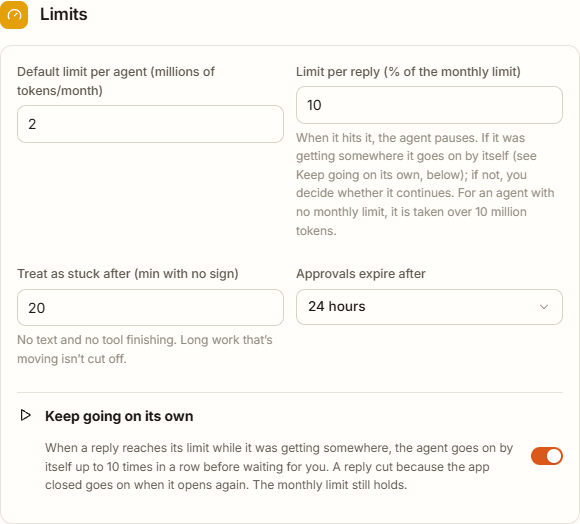
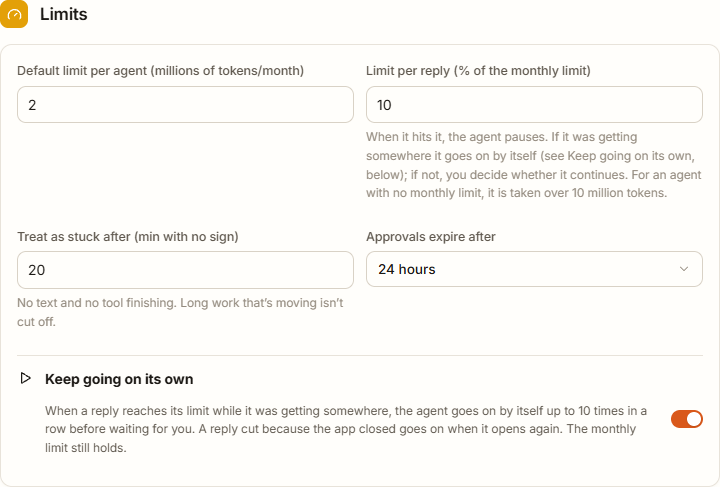
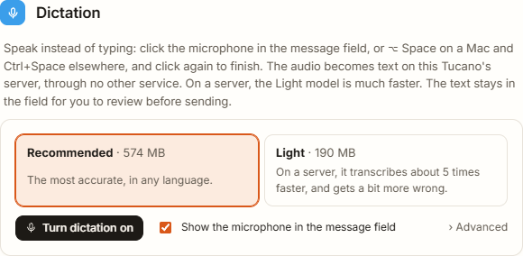

# English copy audit — 22 November 2026

Upstream merged [PR #410](https://github.com/eduwxyz/tucano/pull/410) on 22 November. This audit checks the text added or changed since the last committed round-two review, rather than assuming that merging that PR also reviewed later features.

The editorial inventory covers **1,840 occurrences: 1,638 retained and 202 replacement candidates**. These are proposals, not applied or layout-approved replacements. The audit includes model-facing text and errors as well as interface copy; it does not count 1,840 distinct new interface labels.

[Issue #618](https://github.com/eduwxyz/tucano/issues/618) proposes stable message IDs, versioned locale catalogs, placeholder and plural validation, and a translation contribution workflow. The [proposal text](i18n-proposal.md) is retained here. The issue proposes a small Settings trial before wider migration; no i18n library or new language has been implemented.

## Sources and method

| Reference | Exact revision |
| --- | --- |
| Last committed round-two editorial inventory | `cf9d34fa6fff1fe9a7042a6785c827bb081683b3` |
| Upstream main reviewed | `98554fdd007637409696f98e061973b5ca9338c6` |
| Local next checked against its registry | `9312ed230dc84e3cbd1c6d65f34d5c6232551f6c` |

The old review's recorded capture date is 14 November. Comparing against that exact source revision gives a reproducible range; it also includes later wording from #410. A changed occurrence is not automatically a defect or a previously unreviewed string.

`audit-copy-changes.mjs` extracted the candidate occurrences from the current upstream source using syntax trees. Four independent editorial packets covered Settings, other flows, feature surfaces and core/shared text. The parent reproduced the main findings in source and checked that the packet union preserves every original ID, source location, interpolation and text field. No application source changed in this audit.

| Packet | Reviewed | Retained | Replacement candidates |
| --- | ---: | ---: | ---: |
| Settings and access | 442 | 359 | 83 |
| Conversations, Wiki, Memory and other flows | 433 | 402 | 31 |
| Board, Vault, onboarding, feedback and connection features | 499 | 439 | 60 |
| Core and shared messages | 466 | 438 | 28 |
| Total | 1,840 | 1,638 | 202 |

The [complete editorial inventory](review.json) records the original English, proposed replacement, reason, source file, context and line. A `replace` decision in this document means an editorial candidate. It does not establish that the proposed text has passed behavior or layout review. Do not pass the whole file directly to an application command without completing those checks.

## Findings to address first

| Surface at reviewed upstream head | Finding | Required review before applying |
| --- | --- | --- |
| `Pages.tsx:1981`, Approvals | “Nothing sensitive happens without you” reads as an unconditional guarantee, although the app supports always-allow rules and autonomy. | Describe actions that require approval without implying every sensitive action prompts. Preserve the high-risk protections. |
| `Pages.tsx:3460`, reply budget | “When it hits it” and “taken over 10 million tokens” obscure the threshold and the calculation. | Name the reply limit, progress-dependent continuation and the 10-million-token basis when there is no monthly limit. |
| `Memory.tsx:186`, forgotten memories | “Deleting permanently removes that too” does not identify the record that prevents relearning. | Explain both exclusion from prompts and the consequence of deleting the prevention record. |
| `Dialogs.tsx:317`, agent deletion | “Its ... folder go” is indirect wording for irreversible deletion and does not explicitly name the folder's files. | Name what is deleted and what remains, including messages and usage receipts. Keep the irreversible warning complete. |
| `Routines.tsx:1292`, one-time schedule | “On the next checked day the time hasn't passed yet” is incomplete English. | Describe the next eligible selected day/time and automatic disabling after that run. |
| `Vault.tsx:205`, login validation | The hint requests HTTPS but its example omits `https://`. | Check the address parser and use an example consistent with the input's accepted format. |
| `Vault.tsx:232`, login assignment | “Giving this one takes the other away” hides which login assignment is replaced. | Say explicitly that assigning this login replaces the agent's existing login for that site. |
| `Feedback.tsx:105`, disclosure | The payload and optional screenshot condition are indirect. | Preserve the exact metadata and the conditional screenshot disclosure; do not imply that screenshots always accompany feedback. |
| `Board.tsx:886,953`, history | “split it in” and “Ran by the routine” need grammatical correction. | Preserve task titles, routine names and the history actor. |
| `Vault.tsx:224`, site placeholder | `conta.exemplo.com.br` is an unconditional Portuguese example rather than a localized attribute. | Localize the example without changing an actual stored address. This is outside the English-argument replacement mechanism. |

Core candidates also clarify invalid-image, oversized-feedback, invalid-JSON and endpoint-key errors. Some English tool messages call Vault “Cofre”; review product-name references separately from identifiers, tool names and real 1Password paths. Translating a real path would change behavior.

## Registry checks

The approved-wording check on the recorded local next revision returned **483 approved occurrences, zero known regressions and zero unfamiliar variants**. This establishes the state of registered wording, not complete editorial or layout approval of all current strings.

Using the same registry to inspect upstream returned **108 approved occurrences, 225 known earlier variants and 14 unfamiliar variants**. These are comparison results, not 239 automatic fixes. The registry includes local terminology and navigation decisions, and upstream has different surfaces. Reapplying it wholesale would disregard those differences.

The upstream inventory also counted **6,071 literal/template English occurrences in `L()` across 158 source files**. These include repeated text, prompts and tool output. This measures the catalog migration's current source surface; it is not a count of unique messages or translation defects.

## Validation and remaining work

- The upstream build passed at the exact reviewed revision with `npm run build`.
- All 1,840 editorial rows have a decision, every original row occurs once, and original source metadata is unchanged.
- The upstream issue was created and then read back as open, with the expected title and body.
- Candidate replacements have not been applied, registered as approved copy, published in a product PR, or installed. Behavior checks, expanded/error-state captures and installed Electron verification belong to implementation.
- This is a source/editorial audit. It does not certify every user-visible string: the collector covers `L()` literal/template branches, selected JSX/attributes, `en` properties and literal errors. Dynamically assembled text, resources outside `src`, and other source forms can need separate inspection.

The first baseline capture attempt exposed a stale sidebar selector in the old copy harness. The next attempt exposed missing selectors for the new Settings groups. Both failed visibly instead of treating empty Settings measurements as success. The adapted baseline capture then passed with 50 captures and 116 measured text occurrences across all five Settings groups and Wiki, at 900 and 1280 CSS pixels. The measurements found 18 occurrences above two lines and no measured clipping or overflow. These are occurrence/viewport counts; some longer disclosures and destructive warnings may warrant explicit exceptions.

## Rendered baseline evidence

The [measurement report](layout-measurements.json) records the exact source SHA, viewport, font, available text width, character count, measured lines and overflow for every inspected occurrence. Three reviewed frames are retained below from the 50 raw captures. This is a headless Edge baseline, not installed Electron verification or approval of the replacement candidates. Expanded controls, validation errors and other feature flows still need captures during implementation.

| Reply-limit hint | Available width | Characters | Rendered lines | Estimated two-line sample budget |
| --- | ---: | ---: | ---: | ---: |
| 900-pixel viewport | 267 px | 232 | 6 | 93 characters |
| 1280-pixel viewport | 337 px | 232 | 4 | 116 characters |

Both use Inter Variable at 12 px with an 18.6 px line height. The sample budgets depend on glyphs and word breaks; they are estimates, not limits that prove arbitrary text fits. The narrower frame also shows the adjacent label wrapping, which a hint-only measurement would miss.

A new implementation PR must include a broader gallery of 12–16 annotated frames when that many distinct defects exist, covering existing wording, proposed replacements and relevant wrapping measurements. These three audit baseline frames are not that implementation gallery. Necessary privacy and destructive explanations must remain complete.
